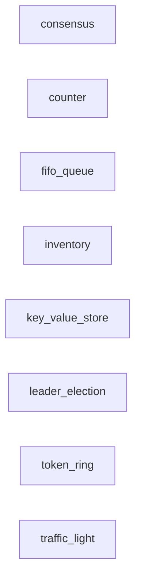

# Canonical TLA+ Examples (RJR-275)

Very simple, self-contained TLA+ models of **canonical scenarios** — the
kinds of systems you reach for TLA+ to reason about. Each is a single file
plus a one-line TLC config, each checks **one canonical property**, and each
is small enough to read in a minute.

This is the follow-on to the main [ReservationSystem](../tla/ReservationSystem.tla)
proof of concept (RJR-267): that model shows the *full* workflow (spec +
mirror + architecture). These examples strip the scaffolding away so you can
see the **shape of a TLA+ model** and the **properties** it proves, across a
range of scenarios.

## The eight scenarios

| # | Example | Scenario | Canonical property checked | Distinct states |
|---|---------|----------|---------------------------|:---------------:|
| 1 | [`TrafficLight`](TrafficLight.tla) | a light cycling green ↔ red | the state is always valid | 2 |
| 2 | [`Counter`](Counter.tla) | a saturating counter | never exceeds the cap | 6 |
| 3 | [`Queue`](Queue.tla) | a bounded FIFO queue | never over capacity | 4 |
| 4 | [`LeaderElection`](LeaderElection.tla) | electing a leader | **at most one leader** | 4 |
| 5 | [`TokenRing`](TokenRing.tla) | mutual exclusion by token | **mutual exclusion** | 6 |
| 6 | [`Inventory`](Inventory.tla) | stock in / stock out | **never oversell** | 5 |
| 7 | [`KeyValueStore`](KeyValueStore.tla) | a key-value map | always well-formed | 4 |
| 8 | [`Consensus`](Consensus.tla) | voting to a decision | **agreement** (same value) | 83 |

The two scenarios named in the issue — **leader election** (#4) and
**stock/inventory checking** (#6) — are both here. The list runs from the
simplest possible model (#1) to the one with the largest state space (#8).

## The shape of a TLA+ model

Every example has the same skeleton, in the same order. Learn it once and
every model reads the same way:

```tla
VARIABLES <state>          -- what the system looks like at any moment
Init == ...                -- the initial state
Next == ...                -- the allowed steps (how the state may change)
Spec == Init /\ [][Next]_VARS   -- all behaviors of the system
<Invariant> == ...         -- a property that must hold in every reachable state
```

- **State** is the whole description of the system at one instant.
- **Actions** (`Next`) are the transitions. Nondeterminism — "some process",
  "some value" — is written with `\E` (there exists), which is how one model
  stands in for *all* the ways the system could behave.
- **`Spec`** is the set of all infinite behaviors starting from `Init`.
- **An invariant** is a property that must be true in *every* reachable
  state. TLC either confirms it holds for all of them, or hands back a
  **counterexample** — a concrete sequence of steps that breaks it.

That last point is the value: you don't test a few scenarios, you get a
guarantee over *all* of them (within the model's bounds).

## Running them

You need [TLC](https://github.com/tlaplus/tlaplus) (the TLA+ model checker),
i.e. a Java install and `tla2tools.jar`. Then, from the repo root:

```sh
# one example
java -jar tla2tools.jar -workers auto examples/TrafficLight

# all eight (the Makefile target)
make examples
```

Expected result for each:

```
Model checking completed. No error has been found.
```

The full captured run for all eight is in
[`tlc_output.txt`](tlc_output.txt). The "distinct states" column above is the
state-space size TLC explored for each — small on purpose, so each model is
readable and instant.

## What each example is really about

- **TrafficLight** — the *shape* of a model, nothing else. Two states, one
  flip. If you can read this, you can read the rest.
- **Counter** — why models must be **finite**. A counter that runs forever
  has an infinite state space TLC can't check; capping it makes it finite,
  and the invariant is the statement that the cap holds.
- **Queue** — a **data structure** as a model: the state is one sequence, and
  the invariant is a bound on its length.
- **LeaderElection** — the **at-most-one** property that every real election
  protocol (Raft, Paxos, bully) must preserve. The model isolates the safety
  property from the machinery that reaches it.
- **TokenRing** — **mutual exclusion**: the token is the mechanism, the
  invariant is the proof that at most one process is in the critical section.
- **Inventory** — the **no-oversell** property from the main model, stripped
  to one variable so the single property can be seen in isolation.
- **KeyValueStore** — the `EXCEPT` operator (updating one field of a map
  without rewriting it) and a **well-formedness** invariant.
- **Consensus** — **agreement**: all processes decide the same value. The
  largest state space here (83 states) because there are many vote/decision
  orderings — and they all agree.

## The code mirror (the anchor)

Each example also has a small Python implementation in [`code/`](code/) — the
same "spec mirrors code" pattern the main model uses (see
[`docs/code-mirror.md`](../docs/code-mirror.md)). This is what **anchors the
tests to the TLA+ models and their state spaces**.

Each mirror module exposes three things, one per part of the spec:

| Mirror function | Mirrors the TLA+ | What it does |
|-----------------|------------------|--------------|
| `initial()` | `Init` | the initial state |
| `successors(state)` | `Next` | the allowed next states (nondeterminism enumerated) |
| `invariant(state)` | the `INVARIANT` line in the `.cfg` | the property that must hold |

The test [`tests/test_examples_state_space_mirror.py`](tests/test_examples_state_space_mirror.py)
does a breadth-first search over the **concrete code** (driving the real
`successors()`) and asserts, for every example:

1. **the TLA+ invariant holds in every reachable state** — if the code ever
   reaches a state the spec says is illegal, the test fails; and
2. **the number of distinct reachable states equals what TLC reported** (the
   "Distinct states" column above, read from `tlc_output.txt`).

That second check is the anchor: if the concrete code's behavior ever diverges
from the abstract model — an extra transition, a missing guard, a state the
spec can't reach — the count won't match TLC and the test fails. The code is
checked against the *actual* state space the model checker found, not a
hand-picked number.

```sh
make examples-py                 # run the mirror for all eight
python3 -m pytest -q examples/tests
```

Expected: **16 passed** (8 invariant + 8 state-space).

## Dependency graph

`code/observe.py` watches `examples/code` as a second target (alongside
`code/reservation`), so the mirror package has its own architecture baseline
(`examples/baseline.json`) and gate. Render the graph:

```sh
make observe-examples                        # or:
python3 code/observe.py --target examples --graph
```



The eight mirrors are intentionally **independent** — each is a standalone
one-property model — so the graph is eight isolated modules with no edges. That
is the honest structure: the examples deliberately don't share code. (The main
model, by contrast, has a real dependency graph — see
`python3 code/observe.py --graph`.)

## How to extend

To add a scenario: create `examples/<Name>.tla` (module name = file name, no
digit prefixes) and `examples/<Name>.cfg` (the `CONSTANT` values, `Spec`, and
the `INVARIANT`), run it, append the result to `tlc_output.txt`, add a row to
the table above, then add a mirror module in `code/` (`initial` / `successors`
/ `invariant`) and a row in the test's `EXAMPLES` list with the TLC state
count. Keep it to **one property** and a **small** state space — that's the
point of this collection.
